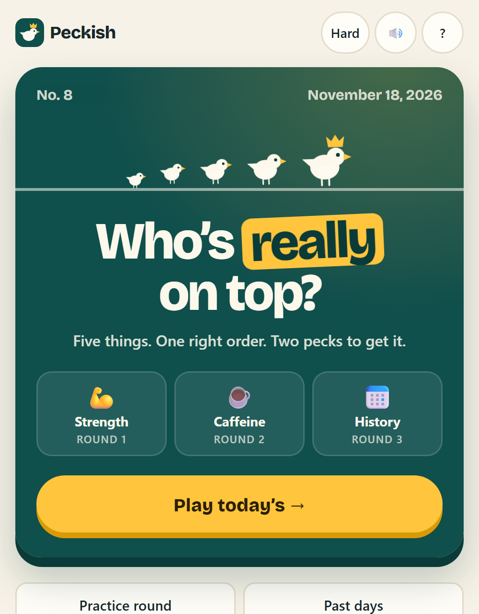

# Peckish

**Play it: https://darrock712.github.io/pecking-order/**



A daily ordering puzzle. Each day everyone gets the same three rounds: five things and a rule ("lightest → heaviest", "oldest → newest"). Put them in the numbered slots (the labels say what goes in slot 1 and slot 5), lock it in, and watch the answer resolve one tile at a time. You get two pecks per round: lock in, read the colours, fix it once.

It takes about a minute a day, runs entirely in the browser, and needs no account.

## Features

- **Three rounds a day**: a warm-up, a trickier one, and a twist round built around something counterintuitive.
- **Mixed-bag rounds** every other day from day 5: five things counted in five different units (pieces, inches, pounds, calories, mph), ranked by the bare number.
- **No category twice in a day**: the dealer skips ahead rather than repeat one.
- **Two pecks per round**: a tile fixed on the second peck scores 4 instead of 6. Tiles flip green (right spot), amber (one place off) or red, with the real value beside each.
- **The reveal shows scale**: each tile grows a bar for its value, then every tile slides to where it really belongs, so you see how wrong (or right) you were at a glance.
- **Near misses are named**: "one swap away" rather than a bare score.
- **Hard mode** hides the rule. You get one solved example set and have to work out what the order means before arranging your own.
- **Streak that counts days played**, not days won. A low score never breaks it.
- **Spoiler-free sharing**: an emoji grid plus a teaser line.
- **Progress at a glance**: round pips with a running score, and a meter comparing today with your average.
- **Practice rounds** and an **archive** of past days, neither of which affects stats.
- Drag, tap-to-swap, or arrow keys; screen-reader labels and live announcements; light and dark themes; reduced-motion support; installable and playable offline.

## Scoring

| | Points |
|---|---|
| Item in the right spot | 6 |
| Item one place off | 3 |
| Perfect round bonus | 3 |
| Perfect day bonus | 1 |

A round is worth up to 33, so three perfect rounds plus the day bonus make exactly 100.

## Run it

```bash
npm install
npm run dev      # local dev server
npm test         # unit tests + content validation
npm run lint
npm run build    # production build in dist/
```

## How it is built

React + TypeScript + Vite, plain CSS, no backend. Progress is stored in `localStorage`.

```
src/
  game/         pure functions, no React, fully unit tested
    daily.ts      puzzle number from the local date, set selection, seeded shuffle, hard-mode example
    scoring.ts    marks, points, verdicts, share text
    stats.ts      streak and totals
    storage.ts    localStorage with safe fallbacks
  data/
    sets.ts       the puzzle content
    sets.test.ts  content rules, enforced in CI
  components/   Round (arrange + reveal), Summary, visual effects
  lib/          number formatting, bar scaling, synthesised sound and haptics
```

Design decisions worth knowing:

- **Sets are stored in their correct order.** An item is right when its index equals its position, which keeps scoring to a few lines and makes content errors easy to spot in review.
- **The puzzle number comes from the player's local calendar date**, projected onto UTC midnight before subtracting, so daylight-saving changes can never skip or repeat a day.
- **The starting shuffle is seeded by the day**, so every player sees the same starting order. It never starts with more than one item already in place.
- **Tiles keep a stable DOM order and move with CSS**, so focus is never lost while reordering with the keyboard.
- **The service worker is network-first**, so fixes and new puzzles arrive immediately and the cache is only a fallback when offline.

## Content

156 sets, enough for 52 days; after that the cycle repeats. They come from two decks: 120 classic sets and 36 "fun stats" sets (snack serving sizes, YouTube subscribers, bite force, LEGO piece counts, caffeine, sugar, spice, world records). The decks are dealt alternately, so a fun-stats day turns up every other day. `npm test` checks that every set has five unique items in rising order, values far enough apart to be a fair question (at least 8% apart, or 3 years / 5 degrees), a short teaser, and a same-rule partner for hard mode.

### Mixed-bag sources

Twelve mixed-bag sets live in `src/data/mixed.ts`. Tests require five different units per set and at least a 20% gap between neighbours. Checked on the web in November 2026: Big Mac 580 kcal (mcdonalds.com US product page), LEGO Titanic 9,090 and LEGO Eiffel Tower 10,001 pieces (Brick Fanatics), Bohemian Rhapsody 5:55 (Radio X), Bugatti Chiron limited to 261 mph (Motor Authority), male hippo about 3,400 lb (San Diego Zoo fact sheet), General Sherman 274.9 ft (NPS figure via Wikipedia), Boeing 747-400 cruise about 567 mph, ostrich egg about 2,000 kcal, hummingbird heart up to about 1,200 beats a minute in flight, Golden Gate Bridge towers 746 ft above the water (goldengate.org).

Not checked against a source (well-known or definitional values written from memory): everything else in the mixed deck, including the Great Pyramid's current height, cheetah, greyhound, Concorde and ISS speeds, giraffe height, T. rex length, blue whale weight, Titanic length, Everest and Eiffel Tower heights, and the counts (keys, bones, teeth, stitches, tiles, floors).

### Fun stats sources

The fun-stats deck was checked against sources in November 2026. Soft numbers are shown as "about" in the game, and every set keeps wide gaps so a small change cannot flip the order.

- Serving sizes: US Nutrition Facts labels as listed by grocers (Goldfish 55 pieces, Cheez-It 27, Triscuit 6, Ritz 5, Doritos about 12, Lay's about 15). Counts shift by bag size and over time; Lay's and Pringles listings disagree by a few chips.
- YouTube subscribers: Soundstripe, HypeAuditor and Tubefilter charts, October 2026 (MrBeast about 520 million, T-Series 316 million, Cocomelon about 200 million). These go stale fastest; recheck every few months.
- Bite force: Field & Stream and BBC Science Focus lists. Only the crocodile figure was measured directly; the rest are estimates.
- LEGO piece counts: Brick Fanatics "biggest LEGO sets" list.
- Caffeine: CSPI caffeine chart. Scoville: Guinness for Pepper X and Carolina Reaper, typical mid-range values for the rest.
- World records, rechecked November 2026 because they keep falling: marathon 1:59:30 (Sabastian Sawe, London 2026, ratified by World Athletics), Rubik's Cube single 2.51 s (Xuanyi Geng, October 2026, from news reports of the WCA result), heaviest pumpkin 1,431.5 kg (Ron Wallace, October 2026, Guinness). Reese's Pieces serving of 51 pieces is from Hershey's SmartLabel.
- Fastest baseball pitch: 105.8 mph (170.3 km/h), Aroldis Chapman, 2010, the Guinness figure. Some lists give the first radar reading of 105.1 mph.
- Not checked against a source (written from memory): candy serving count for Hershey's Kisses, fruit sugar, McDonald's calories (a search did not turn up McDonald's own per-item figures), trophy weights, the other sport speed records, part counts for a piano, car and 747.

Three classic-deck sets were checked against sources in November 2026:

- Blue whale heart rate: 4 to 8 beats a minute on a dive and as low as 2, but 25 to 37 at the surface (Goldbogen et al., PNAS 2019). The item now says "on a dive".
- Kiwi and emu eggs: brown kiwi about 440 g, emu 500 to 700 g, so the order holds.
- The height set used to include an ostrich at 2.5 m. Big males reach about 2.8 m, taller than the tallest man (2.72 m), so it was swapped for a standard door (2.03 m).

The rest of the classic deck was written from general knowledge and reread in November 2026 without finding an order that looks wrong, but it has not been checked against sources. Most are textbook values. These are the ones to verify before sharing widely, because sources vary or the number is an estimate:

- Weight of a cumulus cloud (~500 tonnes) and of the Eiffel Tower (10,100 tonnes including non-metal parts)
- Animal top speeds: black mamba, grizzly bear, house cat, mallard, dragonfly, swift, hippo
- Mantis shrimp punch and trap-jaw ant bite speeds
- Elephant sleep (2 h, from one study of wild elephants)
- Lifespans: queen termite, Greenland shark, bowhead whale, macaw
- Counts that are estimates: trees, ants, chickens, stars in the Milky Way, languages in Papua New Guinea, bones in a newborn
- Lion's mane jellyfish and bootlace worm lengths
- Khmer alphabet letter count (depends on what is counted)
- Populations (2020s figures; these drift)
- Taste bud counts, scallop and box jellyfish eye counts, density of fresh snow
- Records: oldest dog, cat and goldfish; deepest whale and scuba dives; the 1958 Lituya Bay wave (524 m is the run-up height on the hillside)
- Great Wall length (21,196 km is the official survey including all branches)

## Deploy

**GitHub Pages** (workflow included): push to a GitHub repository, then in *Settings → Pages* set *Source* to **GitHub Actions**. Every push to `main` runs lint, tests and build, then publishes `dist/`.

**Vercel**: import the repository. The defaults (`npm run build`, output `dist`) work as they are.

The build uses a relative base path, so it works at a domain root or under `/<repo-name>/` without changes.

### Custom domain (peckish.io)

Not set up yet. Once the domain is registered:

1. Add `public/CNAME` containing the single line `peckish.io` and push.
2. At the registrar, add four `A` records for `@`: `185.199.108.153`, `185.199.109.153`, `185.199.110.153`, `185.199.111.153`, and a `CNAME` record for `www` pointing at `darrock712.github.io`.
3. In *Settings → Pages* enter `peckish.io` as the custom domain, wait for the DNS check, then tick **Enforce HTTPS**.

Saves live in the browser per site address, so streaks on the old `github.io` address do not carry over to the new domain.

## Later

Not built, on purpose, because it needs a server:

- "You beat X% of players today" and "only 12% got round 3 perfect". A single serverless function with a key-value store would do: `POST /result {day, hard, scores[3]}` increments per-day histogram buckets, `GET /stats/:day` returns them. No accounts; one submission per browser, enforced loosely with a local flag.
- More content. 52 days is a starting point, and the validation tests make adding sets safe.
